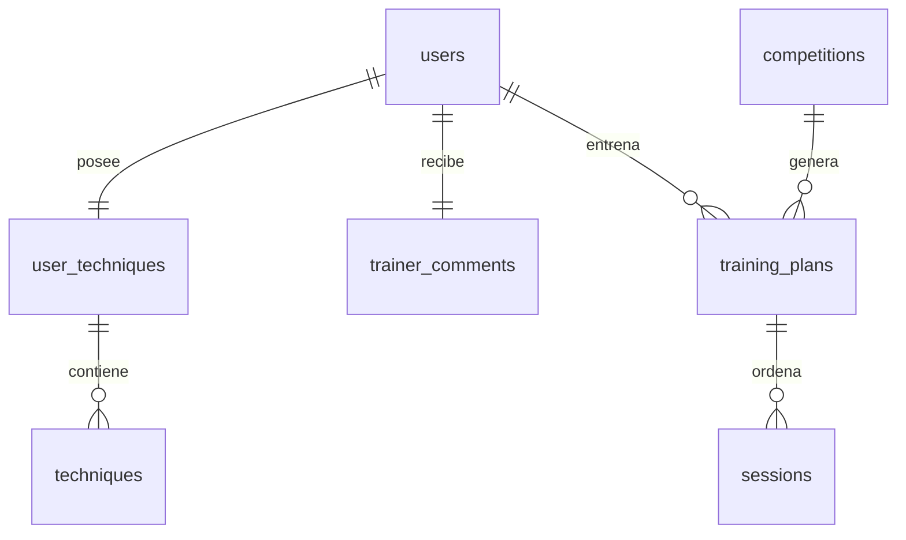

# Consumo Firestore DEV — continuación 21/10/2026

## Estado y alcance

Se continúa feature/firestore-structured-model, originada en main, sin otra implementación. Base remota de trabajo: e18cfe7a875f0344b557e3b2ef4ea125f44fb0a7; develop desplegado: f25a85681d2bb0369da6d4c9fb567a913210305e. main permanece 3b8125cb362f665f908e4028d54514f65f00459a. No merges ni despliegues nuevos en esta fase. Ninguna operación Google real, escritura PRO o modificación del repositorio de datos originales.

El propietario comprobó alta/logout/login satisfactorios con DEV publicado. Se conserva esa evidencia y sus cuentas/datos. No se cambia el PBKDF2, sesiones, permisos, algoritmo, prioridades, continuidad, pasado, PDF ni orden original.

## Investigación: hechos e incertidumbre

- El workflow DEV anterior ejecutaba automáticamente preflight CRUD, preparación con inventario completo, limpieza de legado/bootstrap/recuperación QA, batería real y otro inventario global tras cada publicación. No eran comprobaciones de bajo consumo.
- La batería tenía tres usuarios (dos preparados y otro registrado), doce autosaves para medir latencia, operaciones de roles/planes/eliminaciones y limpieza por múltiples peticiones. Se repitió en distintos intentos del día. El código y logs de Actions acreditan estas operaciones; no existe un ledger por documento que permita atribuir exactamente las 50.000 lecturas a cada proceso.
- Antes, cada edición pequeña preparaba todas las posiciones/técnicas de la revisión y retiraba la anterior. Con 17 posiciones/36 técnicas, el primer cambio de descripción con checkpoint implicaba unas 58 escrituras y 55 eliminaciones de revisión/tarea, más el ACK del evento. Era una amplificación evitable.
- Cada inventario traversaba todos los documentos y subcolecciones; la preparación/verificación permitía hasta 5.000 pasos. La limpieza QA escribía un checkpoint incluso para combinaciones de plan/usuario inexistentes.
- Las lecturas fresh borraban todas las cachés de la operación, aunque se refrescase una sola entidad. Login reconstruía catálogo original y repertorio existentes; listar usuarios leía credenciales privadas innecesarias.
- El tiempo real cancela la alarma después de vaciar el outbox: no se ha demostrado polling indefinido en reposo ni se atribuye a él el pico horario. Sí había consulta de tareas retiradas en cada petición y outbox sin límite explícito. Ambos se acotan.
- Run 39627944845, intento 2: perfiles y credenciales sintéticas comprobados; API/browser login 200 y registro 201. Después apareció Google HTTP429 y también falló la limpieza. El backend descartaba el cuerpo de error: no se puede recuperar retrospectivamente qué cuota exacta falló.
- Las capturas muestran aproximadamente 44–50 mil lecturas, 9–9,5 mil escrituras y 8–8,5 mil eliminaciones. No prueban agotamiento de escrituras. Se retira expresamente esa hipótesis como diagnóstico confirmado. Sin contador actual fiable del período de cuota, no se presupone disponibilidad.

## Cambios

1. Push/PR/dispatch/rerun del workflow ejecutan validación local/transportes interceptados por defecto. El despliegue comprueba runtime/build sin operaciones Firestore de prueba. Se eliminan CRUD preflight, inventarios, bootstrap, recuperación y batería real del pipeline.
2. La batería extensa rechaza ejecución si no recibe un origen local 127.0.0.1. Los dos scripts históricos de inventario/limpieza rechazan antes de cualquier fetch; se elimina su implementación de bucles, conservando un mensaje de compatibilidad.
3. Diferencias pequeñas de documentos + raíz + outbox se guardan atómicamente con CAS en raíz e hijos. Sin cambios: ninguna publicación. ACK correcto: se usa el recibo. ACK perdido: publicationId, sin replay. Staging grande sigue acotado y recuperable.
4. Metadatos de posiciones/checkpoints/comentarios pequeños son arrays/mapas nativos en raíz. Técnicas siguen siendo documentos consultables. positionPriority se deriva y actualiza con CAS; su duplicación acotada permite consultas por prioridad sin replicar nombres/textos. Ordinal es local a posición, evitando reescribir el resto del repertorio al eliminar una técnica.
5. Una sesión acotada contiene sus ejercicios y frontera de continuidad. Se mantienen tablas para valores grandes y lectura del formato ya desplegado. No hay migración general ni conversiones al leer. Una primera modificación de datos anteriores puede retirar sus tablas redundantes una sola vez; no hacerlo mediante barridos.
6. Fresh invalida solo la entidad y sus consultas. Login comprueba raíces existentes y solo carga el catálogo cuando falta el repertorio. El listado público de perfiles no carga hashes. Cambiar nombre/rol no reescribe el hash si no cambia.
7. Outbox: máximo 100 eventos por consulta. Retirada: máximo cuatro tareas, en mutaciones/alarma, sin consulta de GC por GET. Se mantienen autenticación de cada operación, revalidación de sockets, tickets de un uso y ACK posterior al envío.
8. Limpieza QA: agrupa hasta ocho candidatos inexistentes por paso en lugar de una petición/checkpoint por cada uno; conserva comprobación de identidad de ejecución y protección de planes compartidos.
9. Se preparan exenciones de índices para mapas/textos no consultados. No se publican índices ni se amplía IAM; no confundir documento de configuración con índices remotos aplicados.

## Medición local

Medidas del transporte completo de workerd/SQLite/Firestore interceptado, con 17 posiciones, 36 técnicas, tres sockets para probar aislamiento. No son Google real, facturación ni latencias remotas. Son escenarios locales separados; no se deben sumar como presupuesto de una prueba real. El fixture contabiliza documentos devueltos, mínimo de una lectura para consulta vacía, escrituras/eliminaciones intentadas y HTTP Firestore (sin OAuth). No mide entradas de índice, Console ni otros clientes. No se contabilizan peticiones HTTP como si fueran documentos.

| Escenario | Lecturas estimadas | Escrituras | Eliminaciones | HTTP Firestore |
| --- | ---: | ---: | ---: | ---: |
| Inicio de sesión | 8 | 0 | 0 | 8 |
| Mis técnicas: snapshot sin caché | 53 | 0 | 0 | 18 |
| Modificar descripción y notificar sockets | 54 | 3 | 1 | 21 |
| Consultar catálogo de competiciones | 11 | 0 | 0 | 11 |
| Crear competición y dos planes pequeños | 134 | 20 | 5 | 66 |
| Entrenamiento del día: primera consulta | 36 | 10 | 0 | 36 |
| Entrenamiento del día: índice vigente | 32 | 0 | 0 | 28 |
| Sincronización con versiones conocidas | 16 | 0 | 0 | 16 |

La edición incluye publicación y ACK de tiempo real; su eliminación corresponde al evento, no a una técnica/revisión. No sumar otra vez ese coste como “tiempo real”. La recepción WebSocket sin recarga realiza cero llamadas Google por sí misma; una vista fría del entrenador después de recibir el aviso requiere su lectura autorizada (52 lecturas estimadas en este fixture). Mis técnicas ya visible desde IndexedDB no hace una nueva petición por render; la comprobación de versiones está representada por la fila de sincronización. Una primera lectura de Entrenamiento del día construye un índice derivado; repetirla vigente no escribe. La prueba lo afirma explícitamente.

El alta pública por API mide 53 lecturas estimadas, 46 escrituras y 4 ACKs/eliminaciones de eventos, antes de añadir sincronizaciones de navegador. El límite autorizado de escrituras aumenta de 50 a **150** por indicación expresa del propietario para poder incluir el alta. Se mantienen **200 lecturas, 50 eliminaciones, 2 usuarios y una ejecución real por cambio relevante**. Estos límites incluyen preparación y limpieza; elevar escrituras no autoriza sobrepasar las otras dimensiones. La secuencia completa de esta batería sigue excediendo el presupuesto y nunca se ejecutará contra Google.

Instrumentación: NativeFirestore.usage separa HTTP, consultas, lecturas estimadas, escrituras/eliminaciones intentadas y confirmadas y respuestas inciertas. FirestoreUsage puede compartirse entre repositorios de un escenario local; su presupuesto reserva antes de enviar commits y limita consultas sin aceptar resultados truncados como completos. Ese contador por instancia no se presenta como presupuesto global. El acumulador durable compartido, descrito al final de este documento, implementa la reserva global y de limpieza sobre RPC privado; el runner administrativo explícito aplica ahora ese presupuesto, como se detalla al final.

Gate local probado: checkDevOperationGate rechaza proyecto distinto, cuota desconocida o con más de 10 minutos, consumo cercano al 80% gratuito, plan no medido del mismo build, más de 200/150/50, más de dos usuarios o repetición de ejecución. No consulta APIs de facturación ni habilita pruebas por sí mismo. El runner administrativo explícito falla cerrado sin estas condiciones.

Evidencia reproducible: scripts/test-firestore-app-runtime.mjs y docs/evidence/firestore-cost-local-2026-10-21.json. La comparación de 12 escenarios congelados de dominio conserva los resultados exactos; no se regeneran oráculos.

## IndexedDB, funcionamiento sin conexión y límites

El cliente ya envía known con las SHA de IndexedDB y restaura respuestas unchanged desde caché. Comparte cargas en vuelo de fichas y mantiene un único socket por sesión; debounce de autosave y reintentos explícitos de borradores se conservan. No se cambia aquí el contrato online DEV acordado: offline permite consultar caché y conservar/exportar borradores, no confirmar escrituras inexistentes. No se introduce subida automática de borradores ni mezcla entre usuarios.

Siguen existiendo lecturas completas del repertorio cuando hace falta validar una edición o cargar una vista fría; el coste crece con técnicas y sesiones realmente necesarias. Las consultas de listado global siguen siendo necesarias para la pantalla que muestra todos los participantes; no se ejecutan para buscar un login por correo. No afirmar consumo constante para cualquier tamaño de aplicación ni eficiencia demostrada en Google todavía.

## Integridad, limpieza y validación real pendiente

Último inventario limpio acreditado antes del fallo de cuota: users=4, user_techniques=112, trainer_comments=6, training_plans=155, competitions=1, user_plan_assignments=2, technique_catalog=55, settings=2, huérfanos=0 (los conteos incluyen descendientes). Corresponde a las dos cuentas creadas por el propietario y su competición/planes; no son autorización para borrarlas.

El intento posterior dejó limpieza QA incompleta por429. No se ejecuta ahora otro inventario global ni se afirma ausencia de residuos. Cuando exista cuota fiable suficiente, preparar un manifiesto de rutas del marcador qa_runs de esa ejecución; clasificar/contar solo esas entidades y sus revisiones, proteger planes compartidos, presupuestar la eliminación y verificar únicamente las rutas eliminadas. No borrar usuarios por una suposición basada en nombres/correos.

La limpieza de residuos previos es una operación administrativa separada, no preparación repetida de tests. Si el manifiesto excede un presupuesto, detenerse y acordar un tratamiento acotado; no repartirlo en reintentos automáticos para ocultar el total. Catálogo original ya publicado no se recarga ni se reemplaza con datos sintéticos.

Pruebas reales y limpieza quedan pospuestas por falta de cuota actual fiable. Navegador local no disponible por ausencia de Chromium; el pipeline de PR ejecuta Chromium sobre backend interceptado. Hasta revisar CI no se afirma validación de navegador de esta revisión. Este era el estado previo al cierre; la orden posterior de despliegue autoriza la integración en develop. El resultado de CI y despliegue debe comprobarse por separado antes de declarar publicada la revisión.

## Fuentes primarias

- https://firebase.google.com/docs/firestore/pricing — documentos frente a peticiones, consulta vacía, índices.
- https://firebase.google.com/docs/firestore/quotas — Spark, límites y contadores.
- https://firebase.google.com/docs/firestore/manage-data/transactions — atomicidad y lotes.
- https://firebase.google.com/docs/firestore/best-practices — acceso y coste/latencia de consultas.
- https://firebase.google.com/docs/firestore/storage-size — cálculo del límite nativo.

## Relaciones del modelo compactado

positions, checkpoints y comentarios acotados son campos nativos de la raíz; techniques es una subcolección de la revisión activa. sessions contiene ejercicios y continuidad de esa fecha. activeRevision sigue siendo referencia nativa; los fallbacks de tablas grandes se documentan en FIRESTORE_STRUCTURED_MODEL.md. IndexedDB conserva respuestas por versión, sin ser fuente de autorización.

## Resultado local de cierre de esta fase

186 pruebas completas pasaron antes de añadir el caso adicional de orden/fronteras. Después, 14/14 pruebas del modelo (incluido ese caso) y typecheck pasan. Pasan compilación frontend DEV, check:worker, runtime heredado, preflight aislado, runtime nativo con sockets reales de workerd y dry-run DEV. No hay Chromium instalado en este host: la prueba de navegador local se intentó una vez y quedó bloqueada antes de abrir navegador; no es un fallo de la aplicación ni una aceptación remota. El resultado definitivo de navegador se deja al CI aislado de la PR.

Las cifras de tres escrituras corresponden al formato compactado estable. La primera modificación de una revisión anterior puede actualizar la proyección positionPriority y retirar metadatos/hijos redundantes; su coste puntual será mayor. No iniciar conversiones generales para obtener esas cifras ni degradar a código antiguo tras escribir el nuevo formato: el lector de esta PR acepta ambos, pero versiones anteriores no conocen los campos compactados. Revisar esa compatibilidad antes de cualquier rollback DEV.

## Continuación: contador global completado (sin Google)

ExecutionBudget usa un único ledger de metadatos SQLite en una instancia dedicada de DOMAIN_IO. Las reservas de todos los ejecutores se serializan mediante storage.transaction antes de cada petición Google. No almacena documentos, rutas de negocio, correos, contraseñas ni tokens; no añade namespaces, migraciones, bindings ni dependencias pagadas. La apertura comprueba el build actual y un límite máximo de diez minutos de escenario. Abrir de nuevo la misma ejecución falla.

- Se reserva el máximo de documentos de una consulta antes de enviarla; el límite de consulta se reduce al disponible. Si el resultado podría estar truncado, se rechaza y se para el escenario. No se usa como información completa. Consultas con offset/rangos/ordenación o formas no presupuestadas fallan antes de HTTP.
- El presupuesto de limpieza se separa del escenario desde el inicio. Un error, agotamiento o expiración del escenario no lo consume. Al empezar limpieza no se puede volver al escenario.
- ACK perdido de una mutación consume toda la reserva y detiene el escenario: no hay reenvío automático ni crédito optimista. Reservas en vuelo sobreviven a reconstruir el ledger. Settlement es idempotente; cerrar con reservas en vuelo está prohibido.
- HTTP, consultas y documentos estimados se contabilizan por separado. No se afirma conocer facturación de índices ni operaciones de otros clientes/Console. Los límites duros máximos siguen 200/150/50. Las estimaciones y el estado incierto se tratan conservadoramente.

El contexto privado se transmite por privateTransport y DomainIO.run/realtime/acknowledge. No hay endpoint público para abrir o inyectar un presupuesto; la API ordinaria no cambia. La entrada administrativa descrita a continuación aplica el gate antes de Firestore y propaga un contexto único a todo el escenario y limpieza. La API ordinaria conserva su comportamiento y no adquiere un presupuesto de pruebas.

Pruebas añadidas: cinco casos unitarios (reservas concurrentes, limpieza protegida, consultas truncadas, ACK incierto, reconstrucción, expiración y prohibición de PRO) y un runtime de workerd/SQLite con tres ejecutores RPC que comparten el mismo ledger. Dos escrituras se permiten, la tercera se bloquea antes del transporte, dos eliminaciones reservadas limpian los documentos aislados y no se puede reiniciar. Google totalmente interceptado; no se crean usuarios ni documentos reales. El caso se incorpora al CI aislado.

## Prueba mínima conectada y autorización de despliegue

La orden posterior «terminsa y despliega en desarrollo» autoriza integrar esta PR en develop después de CI y desplegar solo DEV. La espera anterior de revisión sin merge queda sustituida para esta entrega. Producción permanece fuera del alcance.

La entrada /api/dev/budget-smoke requiere autenticación administrativa existente, origen DEV exacto, build vigente, evidencia de cuota actual fiable y el perfil medido de presupuesto 200/150/50. No acepta identidades, rutas, contraseñas ni datos de negocio elegidos por el operador. Crea internamente un UUID y contraseña aleatorios, ejecuta una sola identidad sintética y no expone tokens/hashes/contraseña. El mismo ledger determinista por build impide repetir la prueba. La respuesta incluye contadores y resultado de limpieza. No hay tráfico Google previo al gate, excepto la autorización administrativa contra Cloudflare, que no consume Firestore.

Toda la secuencia se ejecuta por los mismos StructuredAppApi, repositorios y transporte privado. El contexto de presupuesto cubre registro, login, snapshot, cambio de nombre, logout/login, lectura de persistencia y eliminación de la cuenta/revisiones/credenciales/eventos propios. El SessionReplica de esta prueba es efímero: no modifica las sesiones de usuarios normales en SECURITY. No es una prueba de frontend contra Google; Chromium y sockets completos siguen validados con backend interceptado, y el propietario ya confirmó alta/logout/login en el DEV anterior.

Medición sobre workerd/SQLite con transporte Google interceptado, forzando el mismo PBKDF2 fallback de 600000 e incluso el catálogo en su formato nativo anterior de 53 hijos: escenario 130 lecturas estimadas/48 escrituras/0 eliminaciones; limpieza 52 lecturas/0 escrituras/47 eliminaciones. Total **182 lecturas, 48 escrituras y 47 eliminaciones**, con un usuario. Quedan 55 lecturas y 47 eliminaciones reservadas para limpieza desde el inicio. Se prueba que todos los documentos previos permanecen exactamente iguales y que una repetición del mismo build se bloquea antes de Firestore. No hay inventario global ni importación del catálogo.

La eliminación física está limitada al UUID asignado y comprobado ausente antes de crear. Un error de escenario ejecuta finally con la reserva de limpieza; un resultado incierto/concurrencia se conserva como fallo, sin reintentos automáticos ni éxito falso. Un apagado duro puede interrumpir finally; el ledger retiene runId y reservas, y el informe no autoriza borrar ninguna identidad preexistente ni reiniciar la prueba. Recuperación manual posterior requiere clasificar ese UUID y cuota suficiente.

Uso explícito, únicamente en develop: workflow_dispatch operation=smoke y quota_evidence con JSON del contador actual del período, de antigüedad menor de diez minutos y por debajo del umbral. Esquema: project, observedAt, source=cloud-firestore-api-quota-current-period y used.reads/writes/deletes enteros. No inventar esos números a partir de una captura redondeada de 24 horas. El script scripts/test-firestore-dev-smoke.mjs valida antes del HTTP y el servidor vuelve a validar. Sin evidencia, la prueba no se ejecuta; desplegar no implica ejecutar smoke. Antes de una nueva prueba real, revisar también los residuos QA antiguos identificados y resolverlos de forma controlada; no se eliminan por ejecutar este smoke.

Validación local final: 192/192 unitarias, typecheck, build PWA, check:worker, runtimes heredados, preflight aislado, ledger compartido, smoke mínimo y runtime documental con sockets satisfactorios. Dry-run wrangler DEV satisfactorio. Toda interacción Google de estas pruebas está interceptada. Evidencia del smoke: docs/evidence/minimal-smoke-local-2026-10-21.json. CI de la revisión final debe confirmar Chromium y despliegue desde develop.
