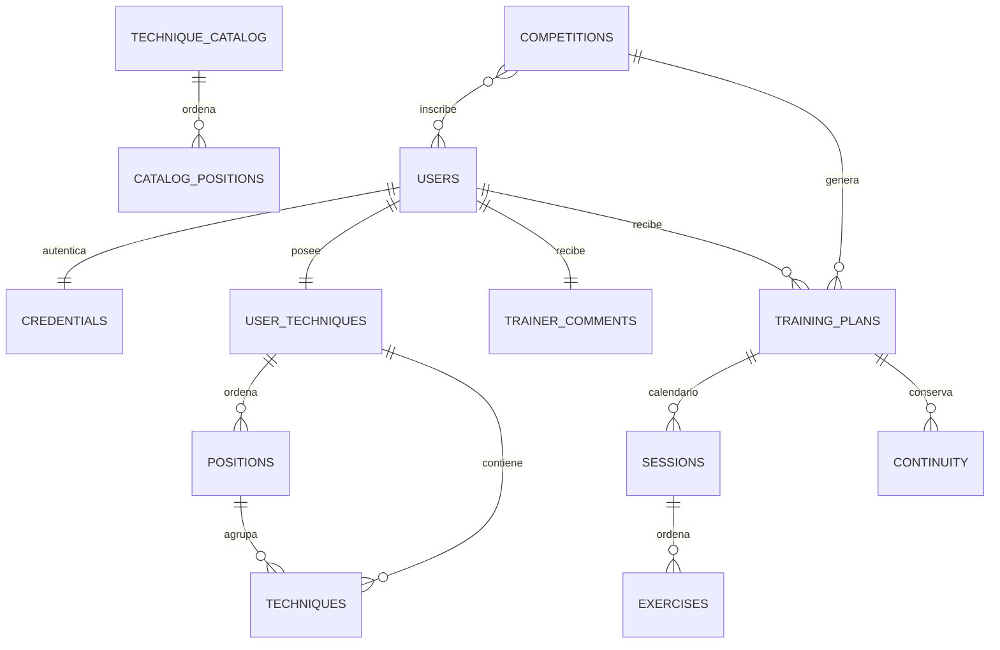

# Auditoría y diseño de Firestore estructurado — DEV

## Alcance y trazabilidad

Encargo 21/10/2026. Rama feature/firestore-structured-model creada desde main 3b8125cb362f665f908e4028d54514f65f00459a.
Incorporación explícita posterior de las dependencias de PR #6, #10 y #11: fuente d8dcd916, develop desplegado f0080f89,
árbol común 0f3296a012dca567b5c1fedbe4bee1d49093d199. Ningún merge a main ni merge automático a develop autorizado. El
Worker PRO, su workflow/configuración y el repositorio de datos originales permanecen fuera de operaciones de escritura.

## Inventario anterior y consumidores

| Entidad                          | Creación/cambios                                             | Lecturas y relaciones                                                               | Persistencia y riesgos anteriores                                                                          |
|----------------------------------|--------------------------------------------------------------|-------------------------------------------------------------------------------------|------------------------------------------------------------------------------------------------------------|
| Usuario y credencial             | AppApi register/profile/password/role                        | login, sesión por mail, entrenador, participante                                    | user_data.json con perfil/pwd; un blob inline ocultaba campos; sesión SQLite por huella de contraseña      |
| Catálogo base                    | inicialización; fixture sustituía catálogo ausente           | cloneTemplate al alta; 17 posiciones/36 técnicas originales                         | tecnics_base.json; UUID se generan por alumno, no copiar identidades                                       |
| Repertorio                       | alumno y recuperación/importación                            | posiciones ordenadas; técnicas UUID; prioridad, descripción; generador y entrenador | tecnics.json; deletedIds/deletionRevision/deletionCatalog/descriptionUpdates son requisitos de continuidad |
| Comentarios                      | entrenador, con autor asignado por servidor                  | UUID técnica, avisos y recálculo futuro                                             | trainer_comments.json; commentUpdates protege versiones por técnica                                        |
| Competición e inscripciones      | entrenador competition/assignment/delete-competition         | catálogo global, alumnos y parámetros de generación                                 | plans.json y alumnos[]; desasignación elimina plan individual; tombstones antes del borrado                |
| Plan individual                  | createMissingPlan; proyección de textos/eliminaciones        | planId + mail; snapshots de sesiones, ejercicios y configuración                    | plan_<UUID>.json; límite lógico 4 MiB; proteger <=hoy y torneos terminados (Madrid)                        |
| Continuidad                      | generador/recálculo puro                                     | catálogo inicial, cursores/pasadas, pendientes, firmas y límites de sesión          | parte del plan; no recalcular ni alterar al transportar                                                    |
| Asignaciones locales remotas     | reconcile desde catálogo                                     | planIds/deletedPlanIds por usuario                                                  | plans_index.json; estado recuperable, no segunda autoridad de inscripciones                                |
| Proyección entrenamiento del día | readTrainingDay bajo demanda                                 | dictionary, fechas, estructura, sourceSha                                           | structure_<UUID>.json; derivado reconstruible; arrays de tuplas requieren conversión a mapas nativos       |
| Sesiones y seguridad             | AppApi mint/revoke y Worker                                  | token opaco, pwdFingerprint, límites, ticket WS de un uso                           | SQLite DO: app-session, ws-ticket, rate, plan-update; nunca almacenar negocio allí                         |
| Tiempo real                      | publicación con escritura y outbox                           | invalidación autorizada, releer desde servidor                                      | pgt_changes; ACK recuperable, alarma y revocación; edición de consola no emite eventos por sí sola         |
| QA                               | endpoint administrativo por UUID                             | tres identidades sintéticas, planes y limpieza                                      | pgt_qa_runs y tombstones/partes antiguas retenidas; inventariar y eliminar controladamente                 |
| Caché/dispositivo                | client-base/OnlineClient y Dexie v4                          | entries/meta/trainerViews/trainerDays/commentNotices                                | aislamiento por propietario; legacy-drafts exportables; no reenviar mutaciones offline                     |
| PDF y exportación                | src/infrastructure/pdf, copia JSON                           | snapshots ya autorizados y cobertura Barlow                                         | sin acceso directo a Firestore; no cambiar resultados ni caracteres soportados                             |
| PRO heredado                     | worker/index, application, storage y cliente sin bandera DEV | GitHub privado por API                                                              | sigue teniendo consumidores PRO: no borrar ni modificar por esta tarea                                     |

Revisión transversal: worker/application.ts, training-day.ts, dev.ts, storage.ts, firestore- *.ts, src/application/*,
src/domain/ *, src/infrastructure/*, main.tsx, ui-*.tsx, tests y scripts de runtime/navegador, workflows DEV/PRO. No
existe funcionalidad pública previa de eliminación de cuentas: la limpieza administrativa debe ser explícita y conservar
autorización/relaciones, sin inventar un botón público.

## Caracterización previa

Suite de 156 casos, doce oráculos completos congelados desde main y guard de hashes de dominio. Mantener esas
referencias. Añadir roundtrip del modelo nativo, orden tras respuestas Firestore desordenadas, datos >1 MiB, CAS, ACK
perdido, fallo durante publicación, limpieza recursiva, catálogo original y equivalencia de API/navegador. Mocks no
acreditan integración remota.

## Modelo objetivo

Usuarios por correo normalizado y perfiles nativos; credenciales en documento privado separado. Colecciones de
catálogo/repertorio con posiciones y técnicas explícitas, UUID y ordinales. Competiciones individuales con alumnos[]
como única autoridad de inscripción. Planes por competición y participante; sesiones por fecha y ejercicios por ordinal;
continuidad y comentarios tipados. Campos nativos, sin JSON funcional serializado, Base64, nombres de archivo ni IDs
hash.

Las revisiones publicadas de agregados grandes permiten staging y cambio CAS de la referencia activa: el límite
histórico de 4 MiB no cabe en un solo documento Firestore de 1 MiB. Las revisiones contienen entidades nativas
(posiciones/técnicas/sesiones/ejercicios), no fragmentos de bytes. Retirar revisiones antiguas con
verificación/reintento de lectores concurrentes; no acumular basura. La firma de ejercicios se representa como mapas
nativos y se recompone al entrar en dominio; la huella hexadecimal del cursor permanece intacta.

## Edición de consola

users/{correo} permite localizar mail, perfil, nombre y demás campos sin decodificación. Cambiar perfil exige invalidar
sesiones/subscripciones y refrescar cliente: releer identidad en cada operación y detectar rol cambiado. Modificar
técnicas, prioridades, comentarios, competiciones, inscripciones, planes o cursores requiere operaciones administrativas
con CAS/revisión, proyecciones e invalidación. No prometer que escribir a mano una subcolección ejecuta lógica de
dominio. Nunca editar hashes de contraseña manualmente; usar reset seguro.

## Catálogo y limpieza

Fuente autorizada exclusiva PGT/master_data/tecnics_base.json del repositorio privado dmda92/pgt-bjj-data, revisión
bfb542c79a086ad6f6e8a9cd5cff0efd2e46635e, 17 posiciones y 36 técnicas. Lectura del catálogo permitida; no leer
users_data ni copiar cuentas. No publicar el catálogo privado en el repo público: inicialización del Worker con lectura
fija del secreto GitHub existente y huella/informe sin datos personales.

Antes de borrar: validar pgt-bjj-dev/ (default), inventariar todas las colecciones/subcolecciones y cantidades,
clasificar finalidad y perfiles. El permiso cubre los usuarios de prueba creados en DEV; cuentas o contenido de origen
real no identificado requieren detener únicamente ese borrado. Nunca borrar a ciegas una colección desconocida. Limpieza
paginada y condicionada, registro sin credenciales, inventario final cero de estructuras antiguas y huérfanos. Rehacer
pruebas de alta/catálogo/roles/tiempo real después. La PR debe quedar abierta para revisión del propietario.

## Corrección de flujo — 21/10/2026

El propietario prohíbe el despliegue directo de feature/* y autoriza explícitamente fusionar la PR #12 en develop para
desplegar y completar DEV. Se elimina la excepción incorrecta del workflow y de los scripts administrativos; las
protecciones del Environment permanecen intactas. Esta autorización posterior sustituye para PR #12 la condición inicial
de dejarla sin fusionar, sin autorizar main ni PRO.
